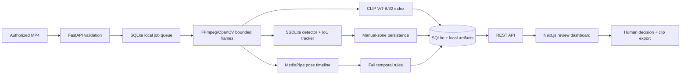

# VisionGuard AI — Phase 1

VisionGuard AI is an offline, human-reviewed video research workspace for semantic moment retrieval and experimental industrial-safety review. It processes authorized recorded footage only. It does **not** connect to live CCTV, recognize faces, identify people, infer intent, or confirm incidents automatically.

This repository is independent from the OpenAI CLIP source repository. It consumes the original OpenAI CLIP package and ViT-B/32 weights at runtime with attribution; no pretrained weights or raw footage are committed.

## What works

- Bounded MP4 upload, FFprobe validation, thumbnails, timestamped frame extraction, progress, cancellation, and failure handling.
- Actual OpenAI CLIP ViT-B/32 image/text inference, normalized 512-D embedding cache, top-K retrieval, and temporal suppression.
- Actual Torchvision SSDLite320 MobileNetV3 COCO inference, bounding-box overlays, confidence filtering, and temporary per-video IoU tracks.
- MediaPipe Pose Landmarker in VIDEO mode plus a conservative temporal fall-candidate state machine.
- User-defined keep-clear polygons, overlap/persistence logic, candidate merging, evidence, and human review state.
- SQLite metadata, local artifact storage, video seeking, event notes, and safe FFmpeg MP4 export.
- Six-page Next.js dashboard backed entirely by real API/database state.

Safety outputs are candidates only: **Potential Fall — Review Required** and **Potential Exit Obstruction — Review Required**. The included safety event is explicitly marked as a synthetic UI fixture, not model evidence.

## Architecture



See [Architecture](docs/ARCHITECTURE.md), [Models](docs/MODELS.md), [Evaluation](docs/EVALUATION.md), [Safety](docs/SAFETY_AND_LIMITATIONS.md), and the [2–3 minute demo](docs/DEMO_GUIDE.md).

## Windows setup

Prerequisites: Python 3.10–3.14, Node.js 20+, NVIDIA CUDA-compatible PyTorch if available, and Git. From PowerShell:

```powershell
git clone https://github.com/MDMinhajul-Islam/VisionGuard-AI.git
cd VisionGuard-AI
git switch feat/visionguard-phase1-mvp
python -m venv .venv
.\.venv\Scripts\python -m pip install --upgrade pip
.\.venv\Scripts\python -m pip install torch torchvision --index-url https://download.pytorch.org/whl/cu128
.\.venv\Scripts\python -m pip install -e ".\backend[test]"
.\.venv\Scripts\python -m pip install "git+https://github.com/openai/CLIP.git@d05afc2a98f2c58574a05c3679d992cf765c940f"
.\.venv\Scripts\python .\scripts\setup_ffmpeg.py
.\.venv\Scripts\python .\scripts\setup_models.py
cd frontend
npm install
cd ..
```

Use CPU wheels instead if CUDA is unavailable. Models are lazy-loaded and CUDA falls back to CPU. Copy `.env.example` to `.env` only when changing defaults.

## Run

Terminal 1:

```powershell
cd backend
..\.venv\Scripts\python -m uvicorn app.main:app --host 127.0.0.1 --port 8000
```

Terminal 2:

```powershell
cd frontend
npm run dev -- --hostname 127.0.0.1 --port 3000
```

Open `http://127.0.0.1:3000`; API docs are local at `http://127.0.0.1:8000/docs`. CORS defaults to localhost only. This prototype has no authentication and must not be exposed publicly.

Generate, seed, process, and evaluate the controlled fixture:

```powershell
.\.venv\Scripts\python .\scripts\generate_demo.py
.\.venv\Scripts\python .\scripts\seed_demo.py
.\.venv\Scripts\python .\scripts\process_demo.py
.\.venv\Scripts\python .\scripts\download_integration_assets.py
.\.venv\Scripts\python .\scripts\evaluate_demo.py
```

## Tests

```powershell
.\.venv\Scripts\python -m pytest backend\tests -m "not integration"
$env:VISIONGUARD_RUN_MODEL_TESTS="1"
.\.venv\Scripts\python -m pytest backend\tests\integration
cd frontend
npm run build
npx playwright install chromium
npm run test:e2e
```

Latest verified evidence is in [evaluations/latest_results.json](evaluations/latest_results.json). On the local RTX 3050 Ti run, 20 deterministic/API tests and 3 real-model tests passed; the Next.js production build and Chromium smoke test also passed. These are engineering checks, not safety accuracy claims.

## Storage and privacy

SQLite, uploads, extracted frames, embeddings, exports, logs, models, and FFmpeg live under ignored `runtime/` or `models/`. Original uploads are never edited. Do not commit private video or generated clips. Clean these folders manually only after confirming no evidence is needed.

## License and attribution

VisionGuard source is MIT licensed. OpenAI CLIP is MIT licensed and governed by its research-oriented [model card](https://github.com/openai/CLIP/blob/main/model-card.md). Torchvision is BSD-3-Clause; MediaPipe is Apache-2.0; FFmpeg licensing depends on the selected build configuration. See [third-party notices](docs/THIRD_PARTY_LICENSES.md).

## Current limitations

- No operational safety certification or real-world event accuracy estimate.
- Fall rules passed deterministic sequences and real pose inference separately; no authorized staged fall video was available for end-to-end validation.
- Exit logic passed deterministic persistence/geometry tests; the synthetic drawing did not yield a model-generated obstruction event.
- COCO SSDLite does not provide reliable helmet, vest, exit-sign, smoke, fire, or generic hazard classes.
- The SQLite queue is one-process/local and is not durable against a host process crash.
- Temporary track IDs exist only within one recording; there is no re-identification.

The highest-value next milestone is a small, consented, staged and frame/event-labeled validation set for falls and keep-clear zones, followed by threshold calibration and event-level error analysis.
