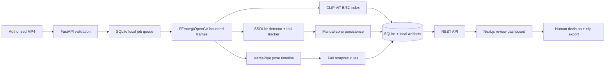
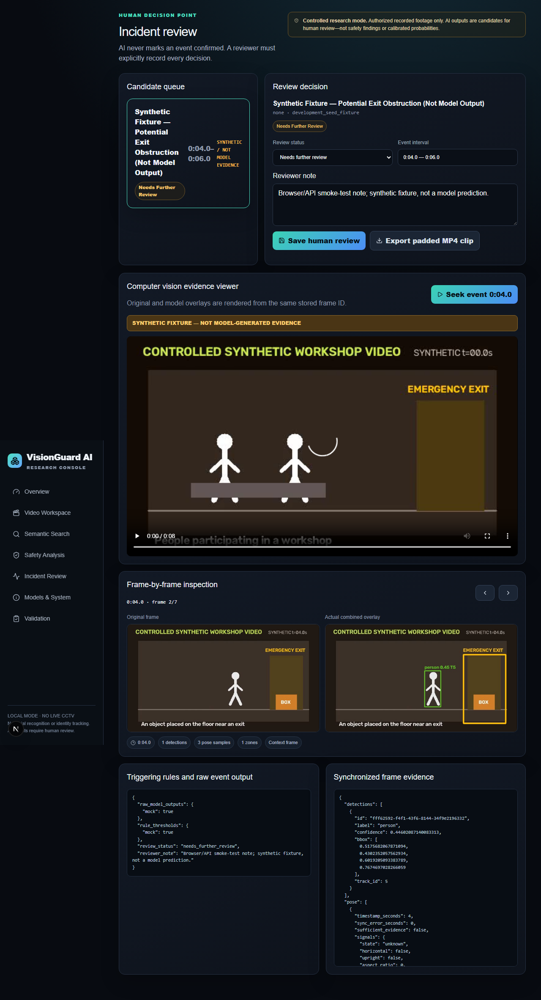

# VisionGuard AI — Phase 2 Research Prototype

## PostgreSQL and tenant isolation

Sprint 5A adds a pinned PostgreSQL 17.11 environment, Alembic history, repeatable SQLite migration, least-privileged application role, transaction-scoped organization/site context, FORCE RLS on tenant media and evidence, direct-SQL isolation tests, and tested backup/restore scripts. SQLite remains an unchanged recovery fallback; PostgreSQL startup refuses an unmigrated schema.

Start with [PostgreSQL Architecture](docs/POSTGRESQL_ARCHITECTURE.md), [Migration](docs/POSTGRESQL_MIGRATION.md), [RLS](docs/ROW_LEVEL_SECURITY.md), and [Backup/Restore](docs/BACKUP_RESTORE.md). This remains a controlled local prototype—not a production deployment or unattended safety system.

Sprint 3 adds a commercial engineering foundation—authenticated local access, role-based authorization, detector adapters, reproducible benchmark records, and crash-recovery safeguards. It does **not** make VisionGuard production-ready or safety-certified.

VisionGuard AI is an offline, human-reviewed video research workspace for semantic moment retrieval and experimental industrial-safety review. It processes authorized recorded footage only. It does **not** connect to live CCTV, recognize faces, identify people, infer intent, or confirm incidents automatically.

This repository is independent from the OpenAI CLIP source repository. It consumes the original OpenAI CLIP package and ViT-B/32 weights at runtime with attribution; no pretrained weights or raw footage are committed.

## What works

- Bounded MP4 upload, FFprobe validation, thumbnails, timestamped frame extraction, progress, cancellation, and failure handling.
- Actual OpenAI CLIP ViT-B/32 image/text inference, normalized 512-D embedding cache, top-K retrieval, and temporal suppression.
- Actual Torchvision SSDLite320 MobileNetV3 COCO inference, bounding-box overlays, confidence filtering, and temporary per-video IoU tracks.
- MediaPipe Pose Landmarker in VIDEO mode plus a conservative temporal fall-candidate state machine.
- Persisted 33-landmark pose evidence, missing-landmark indicators, timing offsets, and explainable trigger measurements.
- User-defined keep-clear polygons, overlap/persistence logic, candidate merging, evidence, and human review state.
- Deterministic ground-truth annotations and one-to-one event-level precision/recall/F1/delay evaluation.
- SQLite metadata, local artifact storage, video seeking, event notes, and safe FFmpeg MP4 export.
- Interactive original/overlay frame viewer and validation dashboard backed entirely by real API/database state.
- Reproducible official-source research-dataset acquisition, safe extraction/conversion, provenance import, real-video evaluation, and a local Dataset Evaluation workspace.
- Recording-disjoint evaluation profiles, Wilson uncertainty intervals, and an explainable pose/motion-fusion experiment.

Safety outputs are candidates only: **Potential Fall — Review Required** and **Potential Exit Obstruction — Review Required**. The included safety event is explicitly marked as a synthetic UI fixture, not model evidence.

## Architecture



See [Architecture](docs/ARCHITECTURE.md), [Models](docs/MODELS.md), [Evaluation](docs/EVALUATION.md), [Phase 2 generalization](docs/PHASE2_GENERALIZATION.md), [Motion fusion](docs/MOTION_FUSION_EXPERIMENTS.md), [Obstruction validation](docs/OBSTRUCTION_VALIDATION.md), [Real datasets](docs/REAL_DATASETS.md), [Safety](docs/SAFETY_AND_LIMITATIONS.md), and the [2–3 minute demo](docs/DEMO_GUIDE.md).

Commercial-foundation documents: [readiness audit](docs/COMMERCIAL_READINESS_AUDIT.md), [detector benchmark](docs/DETECTOR_BENCHMARK.md), [model selection](docs/MODEL_SELECTION.md), [licensing](docs/COMMERCIAL_LICENSING.md), [MLOps](docs/MLOPS_FOUNDATION.md), [production direction](docs/PRODUCTION_ARCHITECTURE.md), and [release gates](docs/RELEASE_GATES.md).

Sprint 4 security documents: [security audit](docs/SPRINT4_SECURITY_AUDIT.md), [tenant isolation](docs/TENANT_ISOLATION.md), [access control](docs/ACCESS_CONTROL.md), [session security](docs/SESSION_SECURITY.md), [audit logging](docs/AUDIT_LOGGING.md), [secure storage](docs/SECURE_STORAGE.md), and [production security gates](docs/PRODUCTION_SECURITY_GATES.md).



## Windows setup

Prerequisites: Python 3.10–3.14, Node.js 20+, NVIDIA CUDA-compatible PyTorch if available, and Git. From PowerShell:

```powershell
git clone https://github.com/MDMinhajul-Islam/VisionGuard-AI.git
cd VisionGuard-AI
git switch feat/commercial-foundation-detector-benchmark
python -m venv .venv
.\.venv\Scripts\python -m pip install --upgrade pip
.\.venv\Scripts\python -m pip install torch torchvision --index-url https://download.pytorch.org/whl/cu128
.\.venv\Scripts\python -m pip install -e ".\backend[test]"
.\.venv\Scripts\python -m pip install "git+https://github.com/openai/CLIP.git@d05afc2a98f2c58574a05c3679d992cf765c940f"
.\.venv\Scripts\python .\scripts\setup_ffmpeg.py
.\.venv\Scripts\python .\scripts\setup_models.py
cd frontend
npm install
cd ..
```

Use CPU wheels instead if CUDA is unavailable. Models are lazy-loaded and CUDA falls back to CPU. Copy `.env.example` to `.env` only when changing defaults.

Generate a strong local `VISIONGUARD_AUTH_SECRET` in `.env`, then create the first administrator interactively:

```powershell
.\.venv\Scripts\python.exe .\scripts\create_user.py --email admin@example.local --name "Local Administrator" --role admin
```

Sprint 4 also requires explicit organization membership. Existing records are preserved in a restricted legacy research workspace and no user receives access automatically. Grant a trusted administrator access explicitly:

```powershell
.\.venv\Scripts\python.exe .\scripts\manage_tenant.py admin@example.local --role organization_admin
```

The browser displays only authorized organizations and sites. API authorization is enforced independently of the selected UI context.

No default password is provided. Outside development mode, token creation refuses to proceed without an explicitly configured secret.

## Run

Terminal 1:

```powershell
cd backend
..\.venv\Scripts\python -m uvicorn app.main:app --host 127.0.0.1 --port 8000
```

Terminal 2:

```powershell
cd frontend
npm run dev -- --hostname 127.0.0.1 --port 3000
```

Open `http://127.0.0.1:3000/login` and sign in; API docs remain local at `http://127.0.0.1:8000/docs`. Administrators manage ingestion/configuration, while reviewers inspect evidence, record decisions, and export clips. This remains local-only and must not be exposed publicly.

Generate, seed, process, and evaluate the controlled fixture:

```powershell
.\.venv\Scripts\python .\scripts\generate_demo.py
.\.venv\Scripts\python .\scripts\seed_demo.py
.\.venv\Scripts\python .\scripts\process_demo.py
.\.venv\Scripts\python .\scripts\download_integration_assets.py
.\.venv\Scripts\python .\scripts\evaluate_demo.py
```

## Tests

```powershell
.\.venv\Scripts\python -m pytest backend\tests -m "not integration"
$env:VISIONGUARD_RUN_MODEL_TESTS="1"
.\.venv\Scripts\python -m pytest backend\tests\integration
cd frontend
npm run build
npx playwright install chromium
npm run test:e2e
```

Latest verified synthetic engineering evidence is in [evaluations/latest_results.json](evaluations/latest_results.json). On the Phase 2 branch, 52 deterministic/API tests and 3 genuine model-integration tests passed; frontend lint had zero errors, the Next.js production build passed, and all three Chromium workflows passed. These are engineering checks, not safety accuracy claims.

The real-video baseline is recorded in [evaluations/ur_fall_real_evaluation.json](evaluations/ur_fall_real_evaluation.json): 20/20 UR videos processed, video-level precision 0.800, recall 0.400, and F1 0.533. This is a small exploratory result with six missed falls and one ADL false alarm—not a safety-performance claim. See [the full protocol and failure analysis](docs/REAL_VIDEO_EVALUATION.md).

Acquire, prepare, import, process, and evaluate the fixed research subset:

```powershell
.\.venv\Scripts\python .\scripts\download_research_datasets.py --dataset ur
.\.venv\Scripts\python .\scripts\prepare_research_videos.py --dataset ur
.\.venv\Scripts\python .\scripts\import_validation_videos.py .\data\external\validation\manifests\ur-balanced-20.json --api http://127.0.0.1:8000 --process
.\.venv\Scripts\python .\scripts\evaluate_real_falls.py --api http://127.0.0.1:8000
.\.venv\Scripts\python .\scripts\evaluate_fall_profiles.py
```

Run the recording-disjoint Phase 2 evaluation (after local acquisition/preparation/import):

```powershell
.\.venv\Scripts\python .\scripts\evaluate_fall_profiles.py --manifest .\data\external\validation\manifests\ur-phase2-heldout-10.json --output .\data\external\validation\reports\phase2-full-diagnostics.json --tracked-output .\evaluations\phase2_profile_evaluation.json
```

Ground-truth manifests can be validated/imported without changing application code:

```powershell
.\.venv\Scripts\python .\scripts\import_validation_manifest.py .\validation\manifests\your-dataset.json --video-id YOUR_LOCAL_VIDEO_ID
.\.venv\Scripts\python .\scripts\evaluate_validation.py --video-id YOUR_LOCAL_VIDEO_ID --event-type potential_fall --split evaluation
```

## Storage and privacy

SQLite, uploads, extracted frames, embeddings, exports, logs, models, and FFmpeg live under ignored `runtime/` or `models/`. Original uploads are never edited. Do not commit private video or generated clips. Clean these folders manually only after confirming no evidence is needed.

## License and attribution

VisionGuard source is MIT licensed. OpenAI CLIP is MIT licensed and governed by its research-oriented [model card](https://github.com/openai/CLIP/blob/main/model-card.md). Torchvision is BSD-3-Clause; MediaPipe is Apache-2.0; FFmpeg licensing depends on the selected build configuration. See [third-party notices](docs/THIRD_PARTY_LICENSES.md).

## Current limitations

- No operational safety certification or real-world event accuracy estimate.
- The recording-disjoint Phase 2 sample contains only five falls and five non-falls. Motion fusion found 4/5 falls with 0/5 non-fall alerts, but uncertainty is wide and participant independence could not be verified.
- Exit logic passed deterministic persistence/geometry tests; the synthetic drawing did not yield a model-generated obstruction event.
- COCO SSDLite does not provide reliable helmet, vest, exit-sign, smoke, fire, or generic hazard classes.
- The SQLite queue is one-process/local and is not durable against a host process crash.
- Temporary track IDs exist only within one recording; there is no re-identification.
- IKAR acquisition remains blocked by official-host timeouts; no suitable physical-obstruction video set was acquired, so obstruction accuracy remains undefined.

The highest-value next milestone is a small, consented, staged and frame/event-labeled validation set for falls and keep-clear zones, followed by threshold calibration and event-level error analysis.
