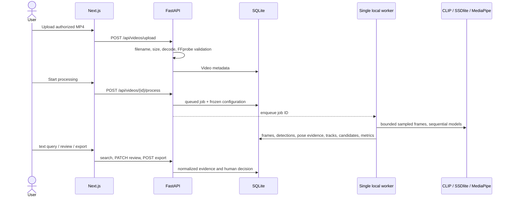

# Architecture

## Boundaries

VisionGuard is a local modular monorepo: FastAPI owns validation, compute, metadata, and safe file delivery; Next.js is a client of the REST API. Large binaries never enter SQLite. Every filesystem lookup is derived from generated IDs and checked against an allowed runtime root.

## Ingestion and jobs

Uploads accept `.mp4` with a bounded size (500 MiB default), sanitized generated filenames, FFprobe metadata, and an OpenCV decode check. The worker receives only a job ID; configuration is persisted as JSON. A single background thread keeps model memory and SQLite write contention bounded. Jobs expose queued/running/completed/failed/cancelled state, stage, progress, error, and measured metrics. This is reliable enough for local development but not durable if the Python process is terminated.

## Sampling and model scheduling

- CLIP uses low-frequency frames (`1.0 s` default).
- detection/tracking uses `2 FPS` by default.
- pose uses `5 FPS` by default; it is never reduced to a still-frame fall decision.
- frames are decoded sequentially at a configured width (640 default), not loaded as the full video.
- CLIP and detector execute sequentially and unload between stages to protect 4 GiB GPUs; MediaPipe runs through its own runtime.

CLIP embeddings are L2-normalized and stored in compressed NumPy arrays alongside frame IDs and timestamps. Search is a matrix dot product followed by temporal suppression.

## Safety event logic

The pose state machine requires an observed upright state, rapid hip descent, a horizontal torso/body signal, and persistence. Low visibility or missing landmarks is `unknown`, not a fall. Zone obstruction requires a manually defined normalized polygon, detector-box intersection, minimum zone occupancy, temporal persistence, gap tolerance, and event merging. Both create pending candidates only.

Pose samples store their original sample timestamp, associated display-frame timestamp, absolute synchronization error, 33 landmarks, missing indicators, and derived signals. Combined overlays are rendered on demand from one `VideoFrame` ID, its actual detections, closest recorded pose sample, and all configured zones. A long pose gap resets rather than advances a fall candidate.

## Data model

`Video` owns `ProcessingJob`, `VideoFrame`, `ObjectDetection`, `PoseEvidence`, `SafetyZone`, `CandidateEvent`, `ValidationAnnotation`, `EmbeddingCache`, and `ExportedClip`. Ground truth is a separate table and never overwrites predictions. Annotation IDs are deterministic hashes of canonical validated content. Candidate events persist raw signals, frozen thresholds, model version, supporting frame IDs, source method, synthetic-fixture provenance, review state, note, and timestamps. Foreign keys and frequently queried video/status/time fields are indexed.

Reprocessing is rejected by default when reviewed model events exist, preventing silent loss of human decisions. Zone re-analysis deletes only pending derived events and preserves already-reviewed events. Cancelled work removes partial analysis rows/files. Reprocessing resets thumbnail provenance before replacing frames.

## API contract

Primary routes are `/api/videos/upload`, `/api/videos`, `/api/videos/{id}/process`, `/api/jobs/{id}`, `/api/videos/{id}/search`, `/detections`, `/events`, `/zones`, `/api/events/{id}/evidence`, `/api/frames/{id}/evidence`, `/api/events/{id}/review`, `/api/validation/annotations`, `/api/videos/{id}/evaluate`, `/export`, `/api/system/info`, and `/api/health`. Pydantic bounds all user-controlled numeric/string values. FastAPI publishes the exact OpenAPI schema at local `/docs`.

## Evaluation protocol

Event matching is greedy one-to-one using temporal IoU (`0.3` baseline) or onset tolerance (`1.0 s` baseline). One prediction cannot match multiple labels, so adjacent frames cannot inflate true positives. Precision/recall/F1 are `null` when their denominators are undefined. Development, calibration, and held-out evaluation splits are distinct annotation fields.

## Export

Export validates `0 <= start < end <= duration`, enforces a maximum interval, resolves source/output beneath known roots, and passes an argument array directly to FFmpeg (never a shell string). It re-encodes H.264 for accurate boundaries and preserves the uploaded source.
